# The Point

Sitio web de **Point**, una app de pádel gratuita para jugadores que reúne partidos, estadísticas, reservas y canchas en un solo lugar. Los clubes se suscriben a un plan para ofrecer reservas, americanos y torneos.

El sitio está desarrollado en **PHP** con base de datos **MySQL**, y se ejecuta en un servidor local con **XAMPP**.

- **Autor:** [Tu nombre]
- **Materia / Institución:** [Nombre de la materia] · [Institución]
- **Repositorio:** [link de este repositorio]

---

## Tecnologías

| Parte | Tecnología |
|---|---|
| Lenguaje del servidor | PHP 7.4 o superior (con PDO) |
| Base de datos | MySQL / MariaDB (InnoDB, utf8mb4) |
| Servidor local | XAMPP (Apache + MySQL) y phpMyAdmin |
| Front-end | HTML5, CSS3 y JavaScript (sin librerías externas) |

---

## Cómo ejecutar el proyecto en local

1. **Instalar y abrir XAMPP.** En el panel de control, encender **Apache** y **MySQL**.
2. **Copiar el proyecto** (la carpeta `point`) dentro de `htdocs` de XAMPP:
   - Windows: `C:\xampp\htdocs\point`
   - Mac: `/Applications/XAMPP/htdocs/point`
3. **Crear la base de datos.** Entrar a <http://localhost/phpmyadmin>, abrir la pestaña **Importar**, elegir el archivo [`database/point_db.sql`](database/point_db.sql) y presionar **Continuar**. Esto crea la base `point_db` con todas las tablas y los datos de prueba.
4. **Revisar la conexión** en [`includes/config.php`](includes/config.php). Por defecto usa el usuario `root` sin contraseña (configuración normal de XAMPP).
5. **Abrir el sitio** en <http://localhost/point/>.

### Usuario de prueba

| Dato | Valor |
|---|---|
| Correo | `demo@point.com` |
| Contraseña | `Point1234` |

También se puede crear una cuenta nueva desde la página **Progresa**.

---

## Estructura del proyecto

```
point/
├── index.php              Inicio
├── app.php                Recorrido por las pantallas de la app
├── livematch.php          Función Live Match
├── play.php               Reservas, clases, americanos, torneos + buscador de clubes
├── raqueta.php            Buscador de palas, "mi pala" y favoritos
├── perfil.php             Pantallas de perfil de la app
├── token.php              Token electrónico y tabla comparativa
├── planes.php             Planes para jugadores y clubes
├── progresa.php           Crear cuenta, iniciar sesión y panel del usuario (zona segura)
├── logout.php             Cerrar sesión
├── preguntas.php          Preguntas frecuentes
├── contacto.php           Formulario de contacto
├── includes/
│   ├── config.php         Datos de conexión a la base de datos
│   ├── init.php           Sesión, conexión PDO y funciones de ayuda
│   ├── header.php         Parte superior compartida (menú de navegación)
│   ├── footer.php         Parte inferior compartida
│   └── ui.php             Funciones que dibujan el celular y los íconos
├── css/styles.css         Estilos
├── js/                    Scripts (menú, pestañas, simulador de golpe)
├── assets/img/            Imágenes
├── database/point_db.sql  Script para crear las tablas y cargar los datos de prueba
├── docs/esquema_base_de_datos.md   Diagrama y detalle de la base de datos
└── capturas/              Capturas de pantalla de la entrega
```

Todos los archivos `.php` tienen comentarios que explican qué hace cada parte.

---

## Cómo navegar por las vistas

El sitio tiene un **menú hamburguesa** (botón de tres líneas arriba a la derecha) que aparece en todas las páginas. Desde ahí se llega a cada vista:

| Vista | Archivo | Qué se ve |
|---|---|---|
| Inicio | `index.php` | Presentación de la app, estadísticas y un simulador de golpe interactivo |
| La app | `app.php` | Recorrido pantalla por pantalla de las cinco secciones de la app |
| Live Match | `livematch.php` | Cómo se registra un partido punto por punto |
| Play | `play.php` | Reservar cancha, clases, americanos, partidos abiertos, torneos y canchas abiertas (pestañas) + **buscador de clubes** conectado a la base de datos |
| Mi raqueta | `raqueta.php` | **Buscador de palas** conectado a la base de datos; con sesión se puede guardar la pala y marcar favoritas |
| Perfil | `perfil.php` | Pantallas de perfil, privacidad y configuración |
| Token | `token.php` | Token electrónico de Point y tabla comparativa |
| Clubes | `planes.php` | Planes (leídos de la base de datos) y pantallas que ven los jugadores |
| Progresa | `progresa.php` | Crear cuenta, iniciar sesión y panel del usuario |
| Preguntas | `preguntas.php` | Preguntas frecuentes (leídas de la base de datos) |
| Contacto | `contacto.php` | Formulario de contacto |

El botón **Descargar** de la barra superior lleva a la franja de descarga de la app que está al final de la página de Inicio.

---

## Cómo enviar los formularios

Todos los formularios se envían al servidor y se **procesan en PHP**. Los que guardan datos (crear cuenta, login y contacto) se validan antes de guardar nada; si hay un error, se muestra un mensaje y los datos escritos se conservan.

| Formulario | Dónde | Método | Campos | Qué pasa al enviarlo |
|---|---|---|---|---|
| Crear cuenta | `progresa.php` (pestaña *Crear cuenta*) | `POST` | nombre, correo, contraseña (mín. 8 caracteres), aceptar términos | Se valida, se revisa que el correo no exista, se guarda en `usuarios` con la contraseña cifrada y se inicia sesión |
| Iniciar sesión | `progresa.php` (pestaña *Iniciar sesión*) | `POST` | correo, contraseña | Se compara con el hash guardado; si coincide, se inicia sesión |
| Contacto | `contacto.php` | `POST` | nombre, correo, asunto, mensaje (mín. 10 caracteres) | Se valida y se guarda en la tabla `contactos`; se muestra el aviso "Gracias" |
| Buscador de clubes | `play.php` | `GET` (`?q=`) | texto (nombre, ciudad o país) | Consulta la tabla `clubes` y muestra los resultados |
| Buscador de palas | `raqueta.php` | `GET` (`?q=`) | texto (marca o modelo) | Consulta `palas` y `marcas` y muestra la ficha |
| Guardar como mi pala | `raqueta.php` | `POST` | id de la pala | **Requiere sesión.** Actualiza `usuarios.id_pala_actual` |
| Favoritos | `raqueta.php` | `POST` | id de la pala | **Requiere sesión.** Agrega o quita la pala en `favoritos` |
| Agregar pala nueva | `raqueta.php` | `POST` | marca, modelo | **Requiere sesión.** Crea la marca y/o el modelo si no existen |

---

## Zona segura y uso de sesiones

La zona segura es el **panel del usuario** de `progresa.php` y las acciones de `raqueta.php` que guardan datos personales (mi pala y favoritos). Solo funcionan con una **sesión de PHP** iniciada.

**Cómo entrar:**

1. Ir a **Progresa** desde el menú (`progresa.php`).
2. En la pestaña **Iniciar sesión**, escribir el correo y la contraseña (por ejemplo, el usuario de prueba) y presionar *Iniciar sesión*.
3. Si los datos son correctos, aparece el panel *"Hola, [nombre]"* con el correo, el plan, la pala actual y las palas favoritas del usuario.
4. Para salir, presionar **Cerrar sesión** (`logout.php`).

**Cómo funciona por dentro:**

- `includes/init.php` ejecuta `session_start()` al inicio de cada página, así que todas pueden usar `$_SESSION`.
- Al iniciar sesión (o crear una cuenta), `progresa.php` ejecuta `session_regenerate_id(true)` y guarda en `$_SESSION` el `id_usuario` y el `nombre`.
- La función `usuario_actual()` (en `init.php`) devuelve esos datos, o `null` si no hay sesión. Con ella cada página decide qué mostrar:
  - **Con sesión:** `progresa.php` muestra el panel privado y `raqueta.php` permite guardar la pala y los favoritos.
  - **Sin sesión:** `progresa.php` muestra los formularios y `raqueta.php` redirige al login (`progresa.php?tab=login`) cuando se intenta guardar algo.
- `logout.php` vacía `$_SESSION`, ejecuta `session_destroy()` y vuelve a `progresa.php`.

**Medidas de seguridad aplicadas:**

- Las contraseñas se guardan cifradas con `password_hash()` y se comprueban con `password_verify()`.
- Todas las consultas usan **sentencias preparadas (PDO)** para evitar inyección SQL.
- Todo texto que se imprime en pantalla pasa por la función `e()` (`htmlspecialchars`) para evitar XSS.
- Se regenera el ID de sesión al iniciar sesión.
- El correo es único en la base de datos, así que no se pueden crear dos cuentas con el mismo correo.

---

## Base de datos

Base de datos: `point_db` · Script: [`database/point_db.sql`](database/point_db.sql) · Detalle completo y diagrama: [`docs/esquema_base_de_datos.md`](docs/esquema_base_de_datos.md)

| Tabla | Para qué sirve |
|---|---|
| `marcas` | Marcas de palas (Bullpadel, Babolat, Siux, etc.) |
| `palas` | Modelos de palas; cada una pertenece a una marca |
| `planes` | Planes: Jugadores (gratis), Club Básico y Club Completo |
| `plan_beneficios` | Lista de beneficios de cada plan |
| `usuarios` | Cuentas de usuario (contraseña cifrada, plan y pala actual) |
| `favoritos` | Palas favoritas de cada usuario (relación muchos a muchos entre `usuarios` y `palas`) |
| `clubes` | Clubes de ejemplo para el buscador de Play |
| `contactos` | Mensajes enviados desde el formulario de contacto |
| `faqs` | Preguntas frecuentes |

**Relaciones (llaves foráneas):**

- `palas.id_marca` → `marcas.id_marca`
- `plan_beneficios.id_plan` → `planes.id_plan`
- `usuarios.id_plan` → `planes.id_plan`
- `usuarios.id_pala_actual` → `palas.id_pala`
- `favoritos.id_usuario` → `usuarios.id_usuario`
- `favoritos.id_pala` → `palas.id_pala`

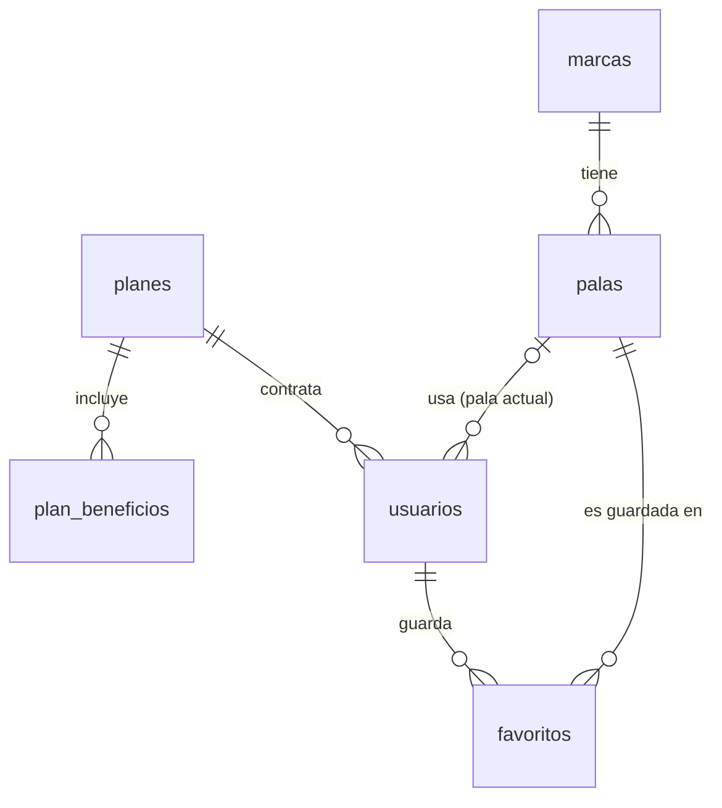

`clubes`, `contactos` y `faqs` son tablas independientes (sin relaciones).

---

## Capturas de pantalla

### Navegación del sitio

| | |
|---|---|
| **Inicio** | 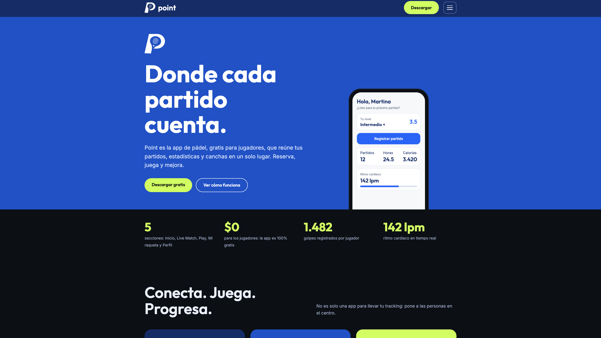 |
| **La app** | 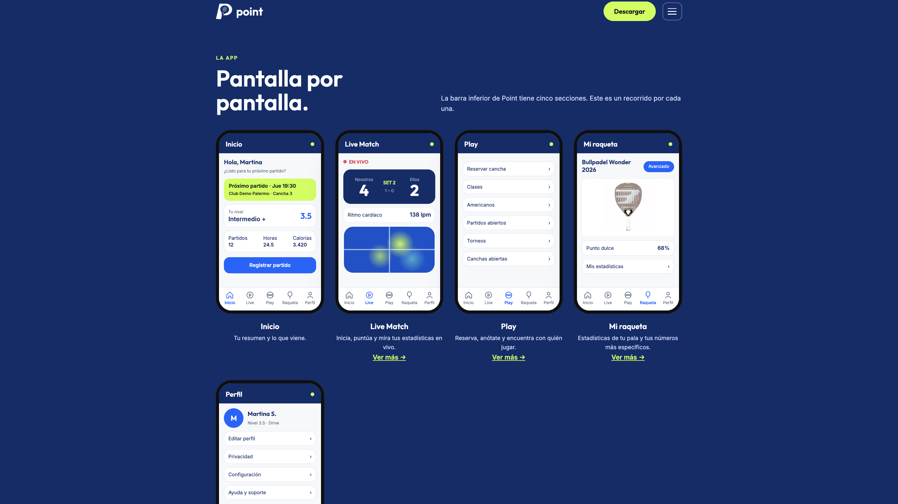 |
| **Live Match** |  |
| **Play** | 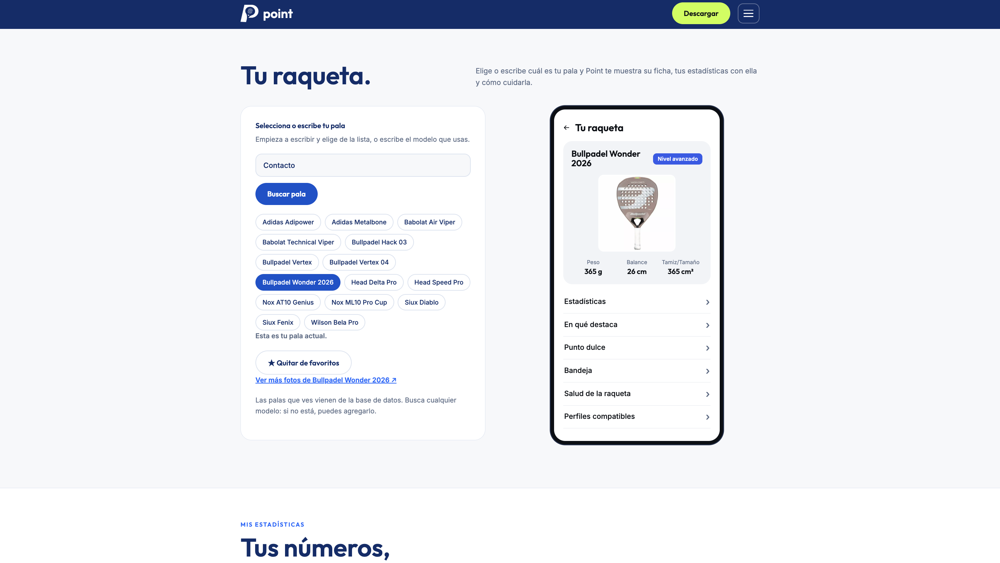 |
| **Mi raqueta** | 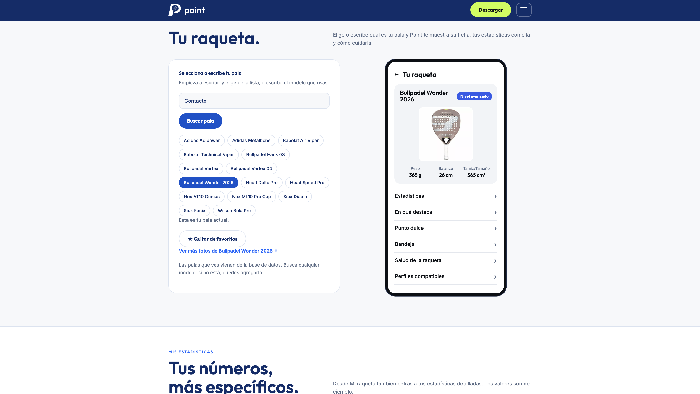 |
| **Perfil** | 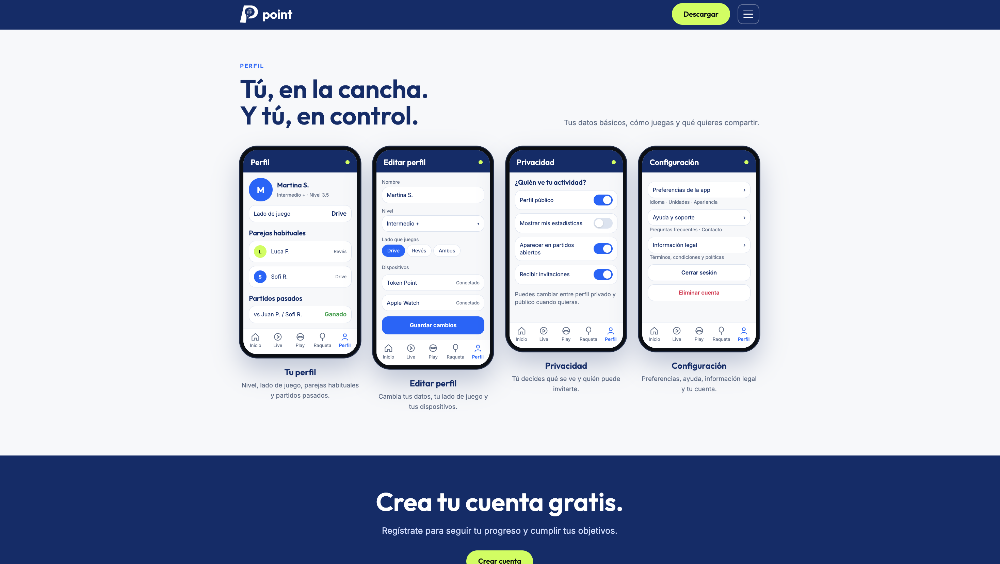 |
| **Token** | 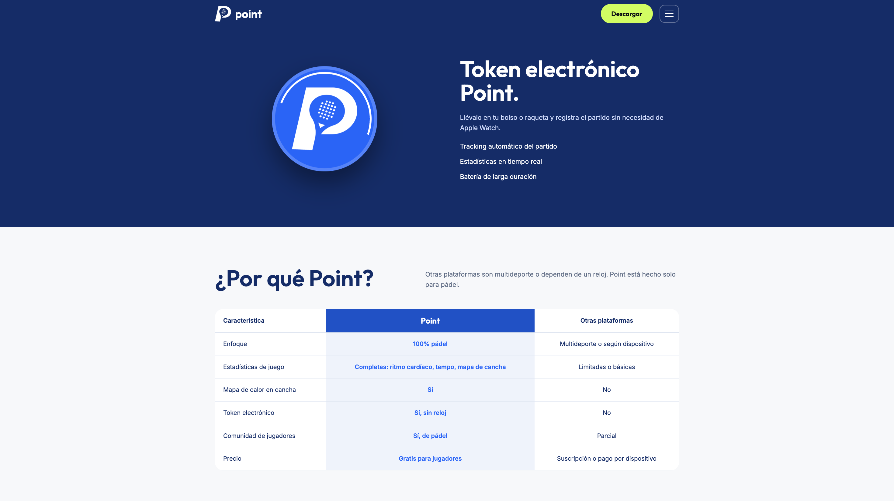 |
| **Clubes (planes)** | 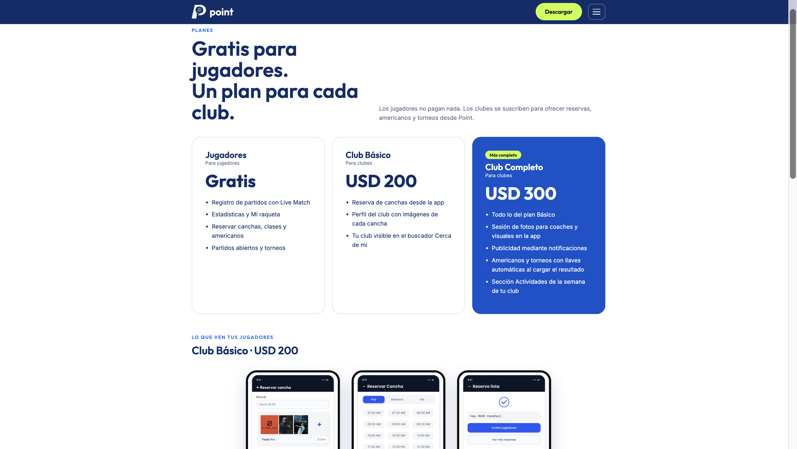 |
| **Preguntas** | 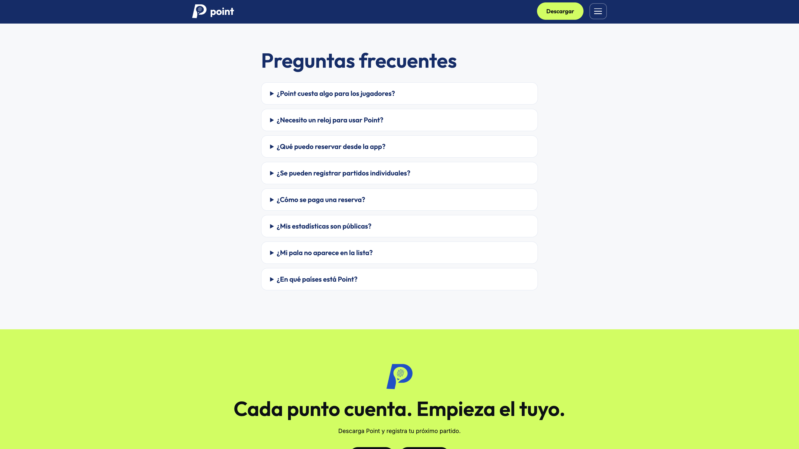 |
| **Contacto** | 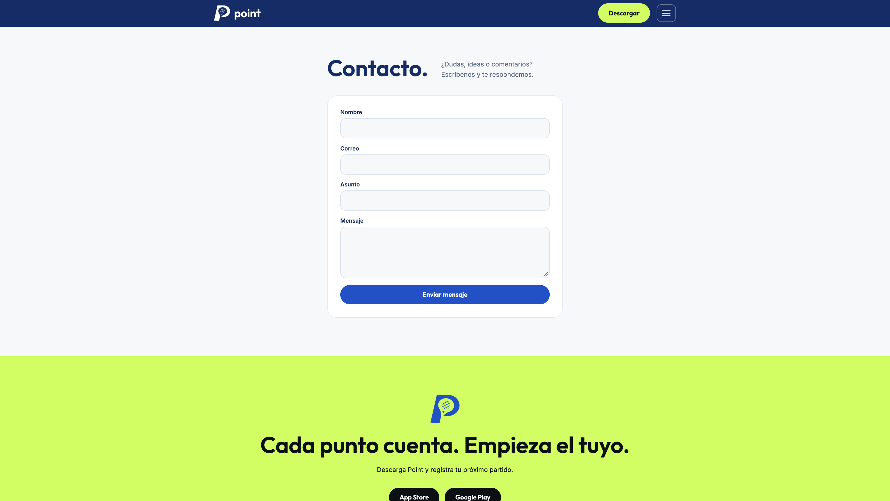 |

### Formularios y zona segura

| | |
|---|---|
| **Crear cuenta** | 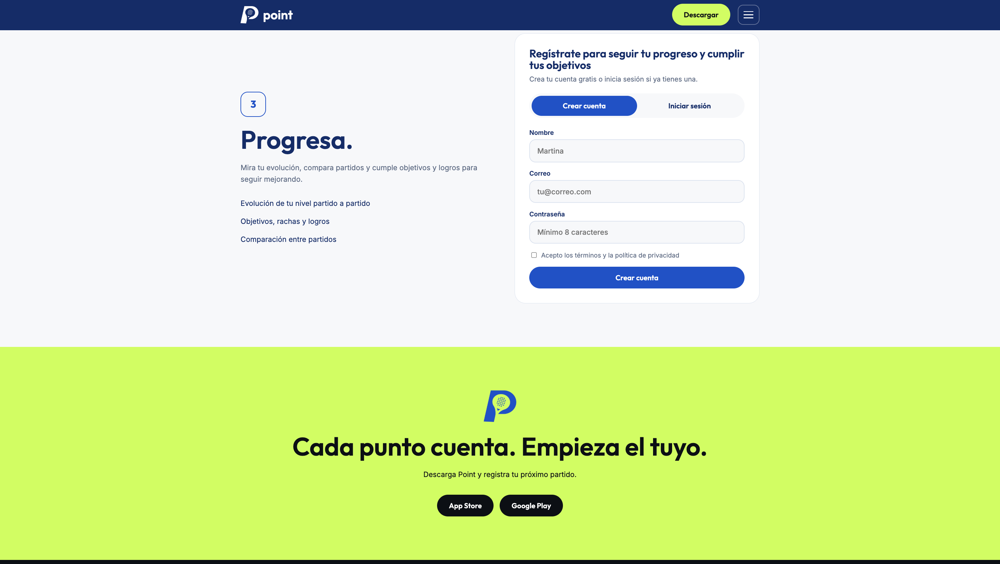 |
| **Iniciar sesión** | 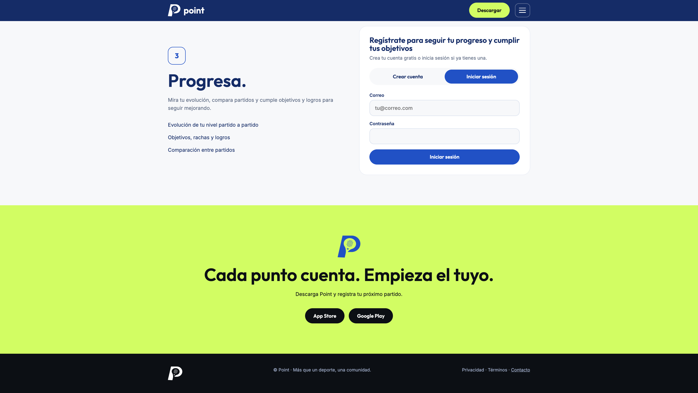 |
| **Zona segura (panel con sesión iniciada)** | 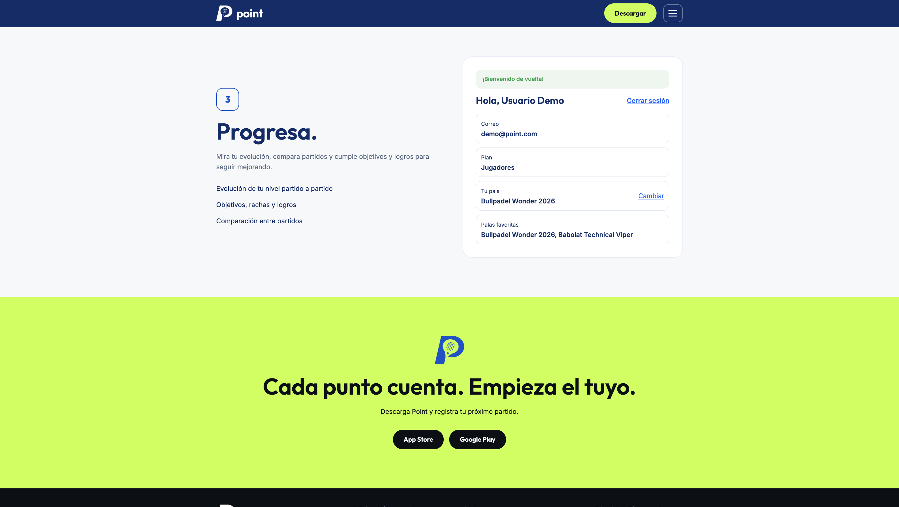 |

### Estructura de la base de datos

| | |
|---|---|
| **Tablas en phpMyAdmin** | 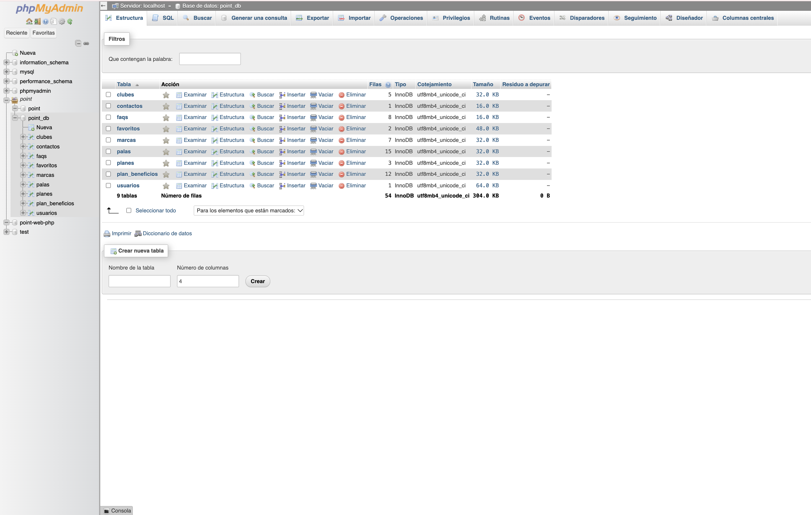 |
| **Diagrama de relaciones (Diseñador)** | 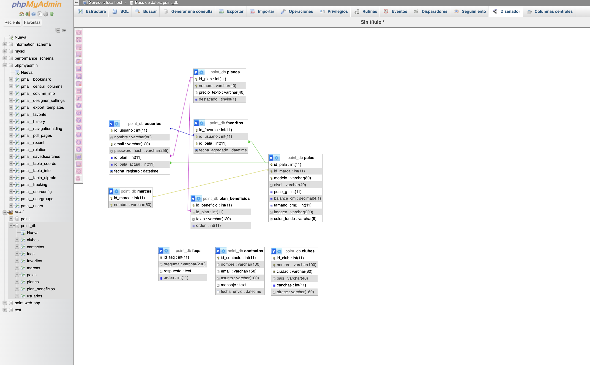 |
