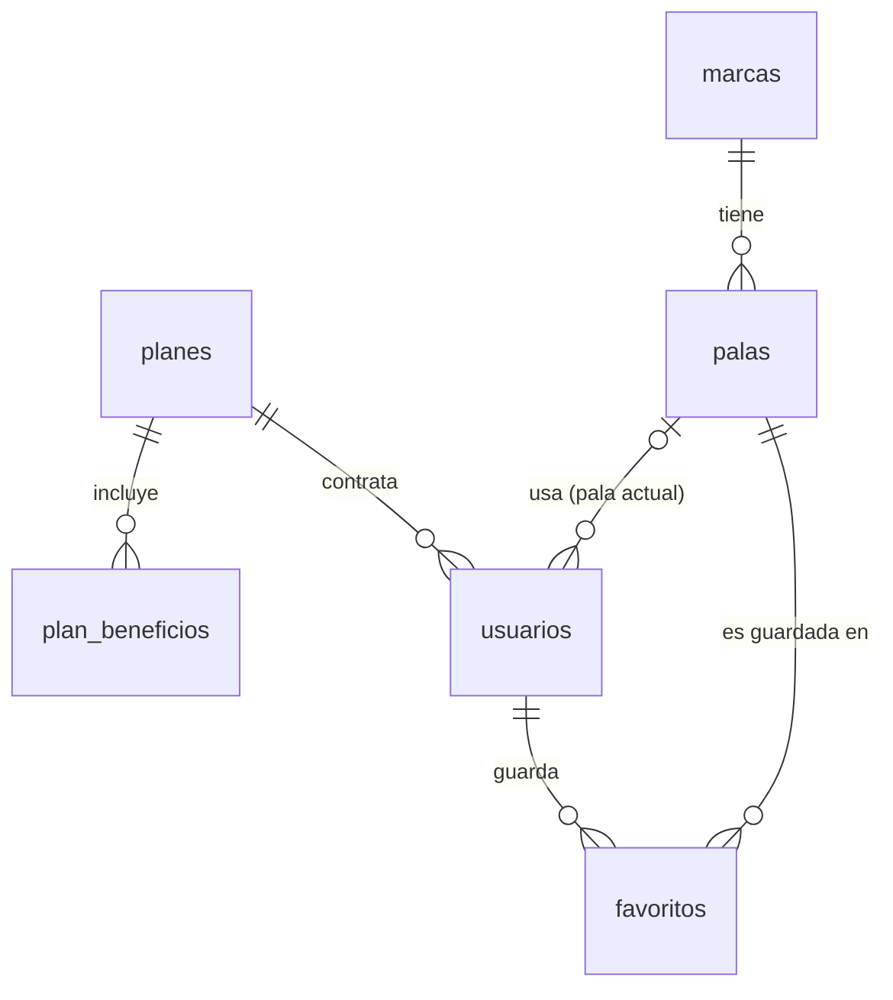

# Point – Esquema de la base de datos

> El diagrama relacional con tablas y flechas se ve en phpMyAdmin → `point_db` → **Más → Diseñador**.

**Motor:** MySQL / MariaDB (InnoDB, utf8mb4) · **Base de datos:** `point_db` · **Archivo:** `database/point_db.sql`

## Diagrama de relaciones

| Relación | Tipo | Llave foránea |
|---|---|---|
| marcas → palas | 1 a muchos | `palas.id_marca` → `marcas.id_marca` |
| planes → plan_beneficios | 1 a muchos | `plan_beneficios.id_plan` → `planes.id_plan` (ON DELETE CASCADE) |
| planes → usuarios | 1 a muchos | `usuarios.id_plan` → `planes.id_plan` |
| palas → usuarios | 1 a muchos (opcional) | `usuarios.id_pala_actual` → `palas.id_pala` (ON DELETE SET NULL) |

| usuarios → favoritos | 1 a muchos | `favoritos.id_usuario` → `usuarios.id_usuario` (ON DELETE CASCADE) |
| palas → favoritos | 1 a muchos | `favoritos.id_pala` → `palas.id_pala` (ON DELETE CASCADE) |

`favoritos` convierte la relación usuarios ↔ palas en **muchos a muchos** (un usuario guarda varias palas y una pala la guardan varios usuarios).
`faqs`, `contactos` y `clubes` son tablas independientes (sin relaciones).

## Tablas y campos

### marcas
| Campo | Tipo | Notas |
|---|---|---|
| **id_marca** | INT AUTO_INCREMENT | **PRIMARY KEY** |
| nombre | VARCHAR(60) | UNIQUE, NOT NULL |
| logo | VARCHAR(200) | ruta del logo, NOT NULL |

### palas
| Campo | Tipo | Notas |
|---|---|---|
| **id_pala** | INT AUTO_INCREMENT | **PRIMARY KEY** |
| id_marca | INT | **FOREIGN KEY** → marcas, NOT NULL |
| modelo | VARCHAR(80) | NOT NULL (UNIQUE junto con id_marca) |
| nivel | VARCHAR(40) | NULL |
| peso_g | INT | NULL |
| balance_cm | DECIMAL(4,1) | NULL |
| tamano_cm2 | INT | NULL |
| imagen | VARCHAR(200) | NULL (ruta de la foto) |
| color_fondo | VARCHAR(9) | NULL (color hex del fondo de la foto) |

### planes
| Campo | Tipo | Notas |
|---|---|---|
| **id_plan** | INT AUTO_INCREMENT | **PRIMARY KEY** |
| nombre | VARCHAR(40) | UNIQUE, NOT NULL |
| precio_texto | VARCHAR(40) | NOT NULL |
| destacado | TINYINT(1) | DEFAULT 0 |

### plan_beneficios
| Campo | Tipo | Notas |
|---|---|---|
| **id_beneficio** | INT AUTO_INCREMENT | **PRIMARY KEY** |
| id_plan | INT | **FOREIGN KEY** → planes, NOT NULL |
| texto | VARCHAR(120) | NOT NULL |
| orden | INT | DEFAULT 1 |

### usuarios
| Campo | Tipo | Notas |
|---|---|---|
| **id_usuario** | INT AUTO_INCREMENT | **PRIMARY KEY** |
| nombre | VARCHAR(80) | NOT NULL |
| email | VARCHAR(120) | UNIQUE, NOT NULL (evita cuentas duplicadas) |
| password_hash | VARCHAR(255) | contraseña cifrada con `password_hash()` |
| id_plan | INT | **FOREIGN KEY** → planes, DEFAULT 1 (Gratis) |
| id_pala_actual | INT | **FOREIGN KEY** → palas, NULL |
| fecha_registro | DATETIME | DEFAULT CURRENT_TIMESTAMP |

### favoritos
| Campo | Tipo | Notas |
|---|---|---|
| **id_favorito** | INT AUTO_INCREMENT | **PRIMARY KEY** |
| id_usuario | INT | **FOREIGN KEY** → usuarios, NOT NULL |
| id_pala | INT | **FOREIGN KEY** → palas, NOT NULL |
| fecha_agregado | DATETIME | DEFAULT CURRENT_TIMESTAMP |

UNIQUE (`id_usuario`, `id_pala`): una pala no se puede guardar dos veces como favorita.

### contactos
| Campo | Tipo | Notas |
|---|---|---|
| **id_contacto** | INT AUTO_INCREMENT | **PRIMARY KEY** |
| nombre | VARCHAR(100) | NOT NULL |
| email | VARCHAR(150) | NOT NULL |
| asunto | VARCHAR(100) | NOT NULL |
| mensaje | TEXT | NOT NULL |
| fecha_envio | DATETIME | DEFAULT CURRENT_TIMESTAMP |

### faqs
| Campo | Tipo | Notas |
|---|---|---|
| **id_faq** | INT AUTO_INCREMENT | **PRIMARY KEY** |
| pregunta | VARCHAR(200) | NOT NULL |
| respuesta | TEXT | NOT NULL |
| orden | INT | DEFAULT 1 |

## Llaves primarias

Cada tabla usa un `id_...` numérico autoincremental como PRIMARY KEY, así ningún registro se duplica y cada uno se identifica de forma única (`id_usuario`, `id_pala`, `id_marca`, `id_plan`, `id_beneficio`, `id_favorito`, `id_contacto`, `id_faq`). Además `usuarios.email` es UNIQUE para que una misma persona no cree dos cuentas.

## Integración con PHP ($_GET y $_POST)

| Archivo | Método | Qué hace |
|---|---|---|
| `progresa.php` | `$_POST` (accion=registro) | Valida e **inserta** un usuario en `usuarios` |
| `progresa.php` | `$_POST` (accion=login) | **Consulta** `usuarios` y verifica la contraseña |
| `progresa.php?tab=login` | `$_GET` | Abre la pestaña de iniciar sesión |
| `raqueta.php?q=texto` | `$_GET` | **Busca** la pala en `palas` + `marcas` |
| `raqueta.php?pala=ID` | `$_GET` | Muestra la ficha de esa pala |
| `raqueta.php` | `$_POST` (accion=guardar_pala) | **Actualiza** `usuarios.id_pala_actual` |
| `raqueta.php` | `$_POST` (accion=favorito) | **Inserta o elimina** una fila en `favoritos` |
| `contacto.php` | `$_POST` | **Inserta** el mensaje en `contactos` |
| `planes.php`, `preguntas.php`, franja de marcas | — | **Leen** `planes`, `plan_beneficios`, `faqs`, `marcas` |

Todas las consultas usan sentencias preparadas (PDO) para evitar inyección SQL.

## Cambios de noviembre

- **`planes`**: la app es gratis para todos los jugadores. Plan 1 = *Jugadores* (Gratis); planes 2 y 3 = *Club Básico* (USD 200: reserva de canchas + imágenes) y *Club Completo* (USD 300: todo lo del Básico + sesión de fotos para coaches, publicidad por notificaciones, americanos y torneos con llaves automáticas, actividades de la semana). `planes.php` muestra además las pantallas clave de la app (`assets/img/app/`). Se quitó el plan *Premium*.
- **`marcas`**: se eliminó el campo `logo`; las marcas solo informan en la ficha de cada pala (ya no hay franja de logos).
- **`palas`**: más modelos de ejemplo. Los usuarios con sesión pueden agregar una pala nueva desde *Mi raqueta* (`$_POST`, acción `agregar_pala`), que crea la marca y/o el modelo si no existen.
- **`clubes`** (nueva): `id_club` (PK), `nombre`, `ciudad`, `pais`, `canchas`, `ofrece`. Alimenta el buscador de clubes de *Play* (`$_GET['q']`). Datos de prueba.

## Páginas PHP

| Archivo | Qué hace | Base de datos |
|---|---|---|
| `index.php` | Inicio, simulador de raqueta | – |
| `app.php`, `livematch.php`, `perfil.php` | Secciones de la app con pantallas de ejemplo | – |
| `play.php` | Reservas, clases, americanos, partidos, torneos, canchas abiertas + buscador de clubes | `clubes` (`$_GET`) |
| `raqueta.php` | Buscador de palas, guardar mi pala, favoritos, agregar pala | `palas`, `marcas`, `favoritos`, `usuarios` (`$_GET` y `$_POST`) |
| `progresa.php`, `logout.php` | Crear cuenta, iniciar y cerrar sesión (sesiones PHP) | `usuarios` (`$_POST`) |
| `planes.php` | Planes para jugadores y clubes | `planes`, `plan_beneficios` |
| `preguntas.php` | Preguntas frecuentes | `faqs` |
| `contacto.php` | Formulario de contacto | `contactos` (`$_POST`) |
